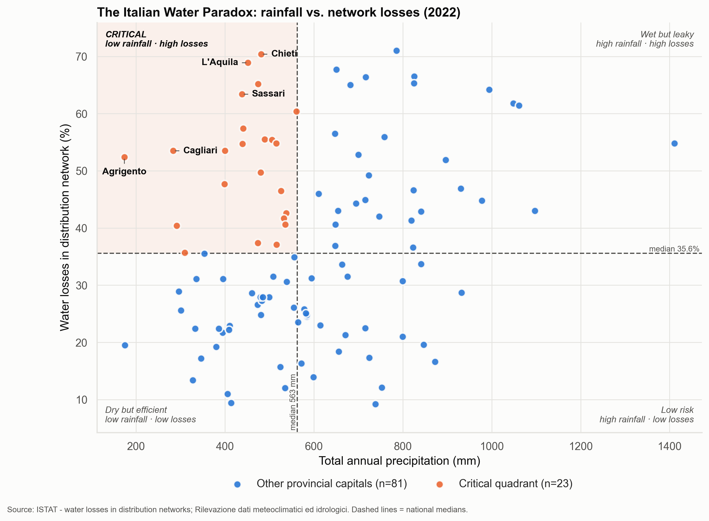

# The Italian Water Paradox: Rainfalls and Leaking Infrastructures

An analysis of Italian provincial capitals that combines rainfall with the
efficiency of municipal water networks, built only on official open data from
ISTAT (the Italian National Institute of Statistics). Exam project for an
*Official Statistics* course.

**Research question:** are the cities that receive the least water also the
ones that waste the most of it?



## Key findings

- In 2022 the median provincial capital lost **35.6%** of the water put into
  its network, ranging from 9.2% (Como) to 71.0% (Potenza).
- Losses follow a sharp territorial divide: median losses are around **26%**
  in the North and above **50%** in the South and the Islands.
- **23 of 104 cities** combine below-median rainfall with above-median losses
  (the critical quadrant). The five most critical are Agrigento, L'Aquila,
  Chieti, Cagliari and Sassari.
- **2022 was not a normal year.** The median capital received only 70% of its
  2006-2021 average rainfall (55% in the North-West). The 2022 national
  correlation between rainfall and losses (r = 0.25) **disappears** on
  2012-2022 averages (r = -0.07).
- The reason is two opposite patterns. **Between macro-areas**, in a normal
  period the wetter North has the most efficient networks and the drier South
  and Islands lose the most: scarcity and inefficiency go together.
  **Within macro-areas**, wetter cities lose slightly more. The 2022 drought
  hit the North hardest and hid the first pattern.
- Altitude does not explain the rainfall effect. Terrain relief was
  significant in 2022 but not on multi-year averages.

The full, automatically generated report is in
[`outputs/report.md`](outputs/report.md).

## Data

All data are official ISTAT statistics for provincial capital municipalities.

| File in `data/raw/` | Content | ISTAT source | Period |
|---|---|---|---|
| `water_losses.csv` | Total water losses in the distribution network (% of volume put into the network) | ISTAT, water statistics for provincial capitals | 2022 |
| `climate_data.csv` | Total annual precipitation (mm) | ISTAT, *Rilevazione Dati meteoclimatici ed idrologici* | 2022 |
| `water_losses_2012_2022.csv` | Same water-loss indicator, all available years | IstatData, dataset `DCCV_URBANENV` | 2012-2022 |
| `meteo_tavole_2021.xlsx` | Annual precipitation per capital (Tavola 1) | ISTAT, *Tavole Dati Meteoclimatici Anno 2021* | 2006-2021 |
| `altimetria_comuni_2021.xlsx` | Altitude of the town centre and terrain relief | ISTAT, *Principali statistiche geografiche sui comuni* | 2021 |

**What "water losses" measures.** The ISTAT indicator is *total* losses:
real losses (physical leaks) plus apparent losses (meter errors, unauthorised
connections). It measures the overall inefficiency of the network, not pipe
failures alone.

## Method

1. **Cleaning** (`src/data_processing.py`): removes ISTAT notes and national
   aggregate rows, converts the ISTAT missing-value markers (`....`, `..`) to
   missing, fixes quoting artefacts in names (`'L"'Aquila'` to L'Aquila),
   standardises city names and reconciles spelling variants between sources
   (e.g. Bolzano/Bozen, Massa Carrara).
2. **Merging**: inner merge on the standardised city name (104 cities in
   2022), plus ISTAT macro-area and altitude. A second dataset averages losses
   and rainfall over the same 8 years (2012-2016, 2018, 2020, 2022; 102 cities
   with at least 6 valid years).
3. **Analysis** (`src/analysis.py`): risk quadrants split by the national
   medians, a criticality score `z(loss) - z(rainfall)`, Pearson and Spearman
   correlations, and OLS regressions of losses on rainfall with macro-area
   dummies, altitude and terrain relief.
4. **Outputs** (`src/visualization.py`, `src/report_generator.py`): four
   figures at 300 dpi and a Markdown report whose text adapts to the computed
   results, so nothing in it is hard-coded.

## Project structure

```
├── data/
│   ├── raw/              ISTAT source files
│   └── processed/        merged_data.csv (2022), multiyear_data.csv (2012-2022)
├── outputs/
│   ├── figures/          risk matrices, top-15 losses, losses by macro-area
│   └── report.md         automated report
├── src/
│   ├── config.py         paths, column names and analysis parameters
│   ├── data_processing.py
│   ├── analysis.py
│   ├── visualization.py
│   └── report_generator.py
├── main.py               runs the whole pipeline
└── requirements.txt
```

## How to run

Requires Python 3.9 or later.

```bash
python3 -m venv .venv
source .venv/bin/activate
pip install -r requirements.txt
python main.py
```

The pipeline rebuilds `data/processed/`, `outputs/figures/` and
`outputs/report.md` from the raw files, and logs every city it excludes and
why.

## Limitations

- Rainfall is measured at one station per city; altitude and terrain relief
  describe the whole municipal territory or the town-hall area, not the
  network itself.
- Earlier rainfall years come from the 2021 edition of the ISTAT tables;
  ISTAT occasionally revises past values.
- The between-macro-area comparison rests on five averages and is
  descriptive only. Correlations and regressions do not imply causation.

## Data licence

Data are published by ISTAT under a Creative Commons Attribution licence (see
the legal notes on [istat.it](https://www.istat.it)). Source: ISTAT.
