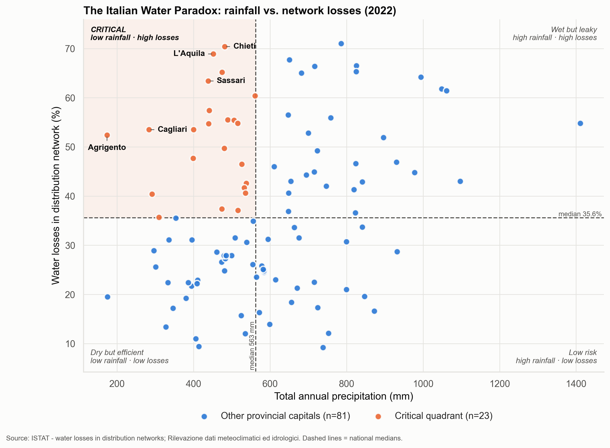
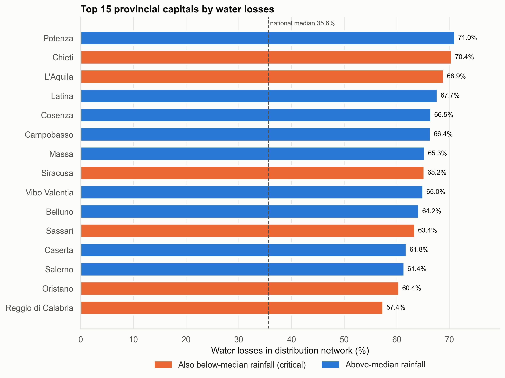
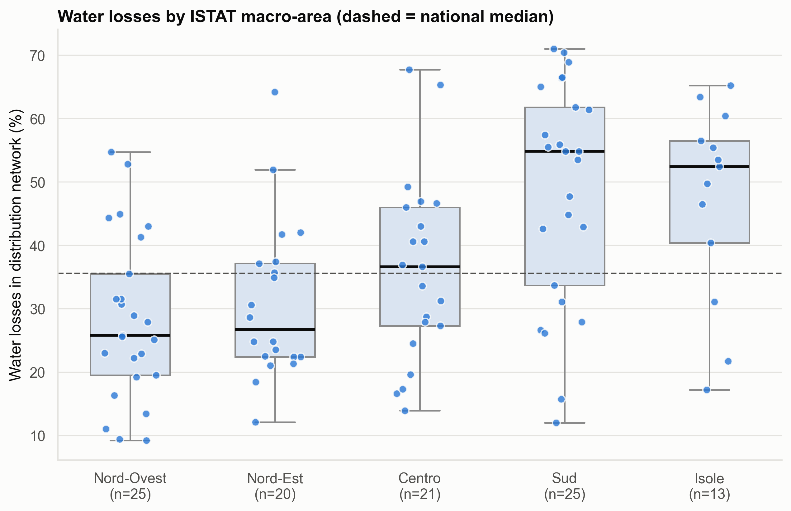
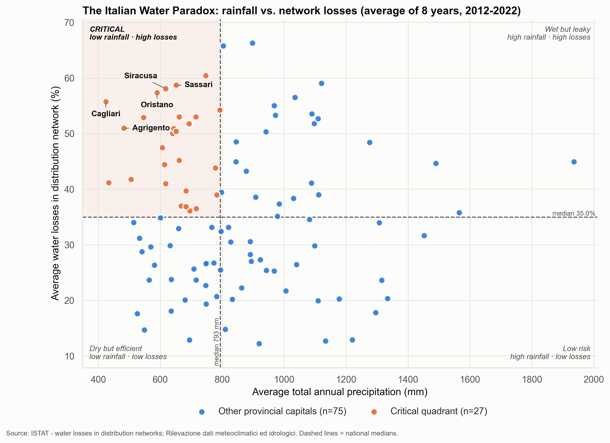

# The Italian Water Paradox: Rainfalls and Leaking Infrastructures

*Automated report generated on 05/11/2026 from ISTAT official data
(reference year 2022, 104 provincial capitals).*

## 1. Key findings

| Indicator | Result |
|---|---|
| Highest water loss | **Potenza** (Sud): **71.0%** of water put into the network is not delivered to users |
| Lowest water loss | Como (Nord-Ovest): 9.2% |
| Lowest precipitation (highest drought risk) | **Agrigento** (Isole): **173.9 mm** in 2022 |
| National median water loss | 35.6% |
| National median precipitation | 562.6 mm |
| Pearson correlation (loss vs. precipitation) | **r = 0.252** (p ≈ 0.009, n = 104) |
| Spearman rank correlation (robustness check) | ρ = 0.215 |
| Cities in the critical quadrant | 23 of 104 |

> **What "water losses" measures.** The ISTAT indicator is *total* losses in
> the distribution network: the share of water put into the network that is
> not delivered to final users. It includes **real losses** (physical leaks
> from pipes and joints) and **apparent losses** (meter under-registration,
> unauthorised connections). The indicator should therefore be read as a
> measure of the **overall inefficiency of the network**, not of pipe
> failures alone: "leaking infrastructures" describes only part of it.

> **Precipitation refers to a single year.** The values describe the weather
> of 2022, not the long-run climate. 2022 was an exceptionally dry year:
> the median capital received only **70%** of its
> 2006-2021 average rainfall, and the North-West just
> 55%. Section 6 repeats the
> analysis on multi-year averages to check that the conclusions survive.

**Interpretation of the correlation.** The Pearson coefficient indicates a weak positive linear relationship, statistically significant at the 5% level. Precipitation explains only about 6% of the variance in water losses (r² = 0.064). The sign is the *paradox*: wetter cities tend to lose slightly *more* water, not less, and drier cities are not systematically better at retaining it. Section 4 checks whether this simply reflects the North-South divide. The correlation should not be read as causal.

> **Caveat.** This national correlation is specific to 2022: on 2012-2022 averages it disappears (r = -0.071, p ≈ 0.474). Section 6 explains why.

## 2. The risk matrix

The dashed lines are the national medians (563 mm and
35.6%), which split cities into four quadrants. The
**critical quadrant** (top-left) contains cities with below-median rainfall
*and* above-median losses: 23 cities.

The five most critical cities are ranked by a criticality score,
`z(water loss) − z(precipitation)`, which standardises both variables so that
distance from the national average counts equally on each axis:

| # | City | Macro-area | Water loss | Precipitation (mm) | Criticality score |
|---|---|---|---|---|---|
| 1 | Agrigento | Isole | 52.4% | 173.9 | 2.88 |
| 2 | L'Aquila | Sud | 68.9% | 452.0 | 2.56 |
| 3 | Chieti | Sud | 70.4% | 481.6 | 2.51 |
| 4 | Cagliari | Isole | 53.5% | 283.8 | 2.43 |
| 5 | Sassari | Isole | 63.4% | 438.6 | 2.29 |

## 3. The worst-performing networks

Orange bars mark cities that also fall in the critical quadrant.

## 4. The territorial divide

| Macro-area | Cities | Median loss | Mean loss | Median precip. (mm) | Critical cities | r (loss vs. rain) within area |
|---|---|---|---|---|---|---|
| Nord-Ovest | 25 | 25.8% | 28.4% | 509 | 1 | +0.43 |
| Nord-Est | 20 | 26.7% | 30.9% | 560 | 4 | +0.37 |
| Centro | 21 | 36.6% | 36.2% | 655 | 1 | +0.10 |
| Sud | 25 | 54.8% | 48.6% | 538 | 8 | +0.27 |
| Isole | 13 | 52.4% | 47.2% | 439 | 9 | +0.37 |

**Does the territorial divide explain the correlation?** To check, water
losses were regressed on precipitation together with the macro-area
(ordinary least squares, with the five macro-areas entered as dummy variables).
Macro-area alone explains 25% of the variance in water losses; adding precipitation raises this to 32%. Holding the macro-area constant, every additional 100 mm of rain is associated with +2.2 percentage points of losses (t = 3.09, p ≈ 0.002; partial correlation r = 0.30). The rainfall-loss relationship therefore **persists within macro-areas**: it is not explained by the North-South divide. One plausible explanation is terrain: hill and mountain towns receive more rain and also run networks with steeper gradients and higher pressures, which are harder to keep tight. Section 5 tests this with ISTAT altitude data.

## 5. Does altitude explain it?

If the rainfall effect were really a terrain effect, adding altitude to the
model should make it disappear. Altitude is the height of the town centre
(the census section hosting the town hall), which is where the urban network
sits; terrain relief is the standard deviation of altitude across the
municipality, a measure of how hilly it is.

Simple correlations: altitude vs. losses r = 0.26;
altitude vs. rainfall r = 0.17; relief vs. losses
r = 0.28.

| Model | Rain (pp per 100 mm) | Terrain (pp per 100 m) | R² |
|---|---|---|---|
| A. Rain + macro-area | **+2.23** (t = 3.09) | - | 0.320 |
| B. A + altitude of town centre | **+1.99** (t = 2.74) | +1.35 (t = 1.73) | 0.340 |
| C. A + terrain relief (std. dev. of altitude) | **+1.66** (t = 2.31) | **+3.14** (t = 2.88) | 0.374 |

*Coefficients in percentage points of water loss; all models include
macro-area dummies; bold = significant at the 5% level.*

Adding the altitude of the town centre changes the rainfall coefficient from +2.23 to +1.99 percentage points per 100 mm (11% smaller). Rainfall **remains significant** (p ≈ 0.006), so altitude does **not** explain the rainfall-loss relationship: the terrain hypothesis is not supported as a full explanation. Altitude itself is not significant once rainfall and macro-area are in the model (p ≈ 0.084).

Terrain relief tells a clearer story than altitude: towns with more uneven terrain lose more water (+3.1 percentage points per 100 m of standard deviation, p ≈ 0.004), consistent with the idea that height differences within the network, rather than height itself, make it harder to keep tight. With relief in the model the rainfall coefficient falls to +1.66 (25% smaller) but stays significant (p ≈ 0.021). Terrain explains part of the rainfall effect, not all of it.

## 6. Robustness: was 2022 representative?

### How unusual was 2022 rainfall?

Each city's 2022 rainfall is compared with its own 2006-2021 average
(ISTAT, Tavole Dati Meteoclimatici 2021):

| Macro-area | Median 2022 rainfall, % of 2006-2021 average |
|---|---|
| Nord-Ovest | 55% |
| Nord-Est | 70% |
| Centro | 79% |
| Sud | 82% |
| Isole | 69% |
| **Italy (all capitals)** | **70%** |

The five capitals furthest below their usual rainfall:

| City | Macro-area | 2022 rainfall (mm) | % of 2006-2021 average |
|---|---|---|---|
| Mantova | Nord-Ovest | 175 | 29% |
| Torino | Nord-Ovest | 301 | 32% |
| Monza | Nord-Ovest | 406 | 34% |
| Agrigento | Isole | 174 | 34% |
| Milano | Nord-Ovest | 328 | 39% |

Because the drought hit the North much harder than the South, the 2022
ranking of "dry" cities is distorted. A more reliable comparison averages
both variables over the same years.

### Multi-year averages (2012-2022)

Water losses and precipitation are both averaged over the 8
years for which ISTAT publishes water losses (2012, 2013, 2014, 2015, 2016, 2018, 2020, 2022), so the two
variables cover exactly the same period. Cities need at least
6 valid years for each variable; 102 of
104 qualify.

|  | 2022 only | Average 2012-2022 |
|---|---|---|
| Cities | 104 | 102 |
| Median water loss | 35.6% | 35.0% |
| Median precipitation (mm) | 563 | 793 |
| Pearson r (loss vs. rain) | 0.252 (p ≈ 0.009) | -0.071 (p ≈ 0.474) |
| Spearman ρ | 0.215 | -0.093 |
| Rain, pp per 100 mm (model A) | **+2.23** (p ≈ 0.002) | **+1.15** (p ≈ 0.009) |
| Altitude, pp per 100 m (model B) | +1.35 (p ≈ 0.084) | +0.45 (p ≈ 0.453) |
| Terrain relief, pp per 100 m (model C) | **+3.14** (p ≈ 0.004) | +0.94 (p ≈ 0.268) |
| Rain once relief is included (model C) | **+1.66** (p ≈ 0.021) | **+1.00** (p ≈ 0.029) |
| Cities in critical quadrant | 23 | 27 |
| Top 5 critical cities | Agrigento, L'Aquila, Chieti, Cagliari, Sassari | Cagliari, Oristano, Siracusa, Agrigento, Sassari |

*Models include macro-area dummies; bold = significant at the 5% level.*

The national correlation **does not hold**: with multi-year averages it is r = -0.071 and no longer significant (p ≈ 0.474). The 2022 value was a product of that year's unusual rainfall pattern. 

**Why: two opposite patterns.** The national correlation mixes a comparison *between* macro-areas with one *within* them. Between macro-areas, the correlation of the five area averages is r = -0.90 on multi-year data: in a normal period the wetter North also has the most efficient networks, while the drier South and Islands lose the most water. At the national scale, scarcity and inefficiency therefore go together. Within macro-areas the relationship goes the other way (partial r = 0.26; rainfall coefficient +1.15 pp per 100 mm, p ≈ 0.009): among cities of the same area, the wetter ones lose slightly more. In 2022 the drought made the North almost as dry as the South (between-area r = -0.13), which hid the first pattern and left only the second. The between-area figure rests on five averages and is descriptive only.

The terrain-relief effect of Section 5 is **not robust**: on multi-year averages it shrinks to +0.94 pp per 100 m (p ≈ 0.268), so it should be treated as a 2022-specific finding. The critical quadrant contains 27 cities on multi-year averages; 21 of the 23 critical cities of 2022 are critical in both.

## 7. Methodological notes

- **Sources**: ISTAT, total water losses in the municipal distribution
  networks of provincial capitals; ISTAT, *Rilevazione dati meteoclimatici ed
  idrologici* for total annual precipitation; ISTAT, *Altimetria Comuni al
  31 dicembre 2021* (Principali statistiche geografiche sui comuni) for
  altitude; ISTAT IstatData (water losses 2012-2022) and ISTAT *Tavole Dati
  Meteoclimatici Anno 2021*, Tavola 1 (precipitation 2006-2021) for the
  multi-year check.
- **Multi-year averages**: simple means over 2012, 2013, 2014, 2015, 2016, 2018, 2020, 2022
  (precipitation for the earlier years from the 2021 edition of the ISTAT
  tables, 2022 from the 2022 release; ISTAT
  occasionally revises past values in later editions). Missing years are
  skipped; cities with fewer than 6 valid years for either
  variable are excluded. The 2022 water losses in the series
  match the cross-section exactly.
- **Indicator**: total water losses in distribution (% of the volume put into
  the network) = real losses + apparent losses. The two components cannot be
  separated with this dataset, so the indicator measures the overall
  inefficiency of the network rather than physical leakage only.
- **Reference year**: both datasets refer to 2022.
- **Altitude**: the town-centre altitude refers to the census section of the
  town hall; terrain relief is computed over the whole municipal territory,
  which may include uninhabited mountain areas far from the network. Both are
  2021 values, adequate for 2022 since terrain does not change.
- **Unit of analysis**: provincial capital municipalities. ISTAT aggregate rows
  ("Capoluoghi di provincia", "Capoluoghi di città metropolitana") were removed.
- **Missing data**: cities flagged by ISTAT with the missing-value marker
  `....`, and cities present in only one source, are excluded by the inner
  merge (see the pipeline log for the list).
- **Thresholds**: quadrants use medians rather than means because both
  distributions are skewed and medians are robust to outliers.
- **Limitations**: precipitation comes from one year (2022, an exceptional
  drought year) and one station per city, so it captures that year's weather
  rather than long-run climate; multi-year averages or ISTAT climate normals
  would be a sounder measure. Correlation and regression do not imply causation.
